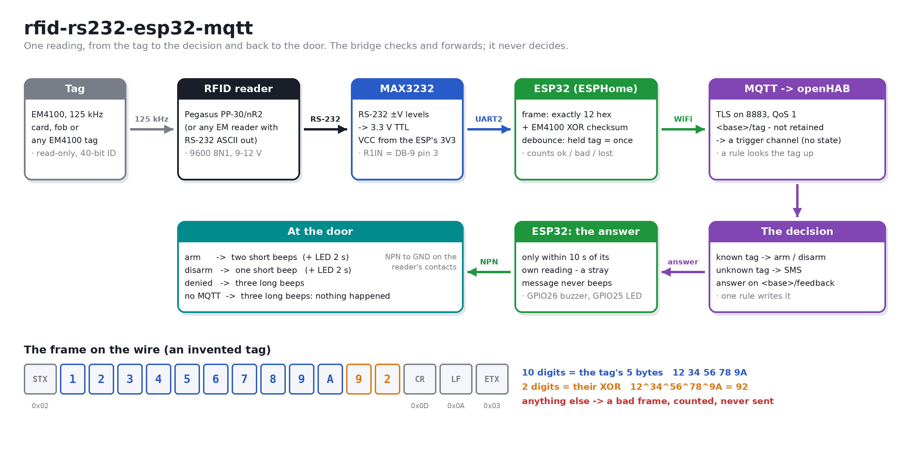
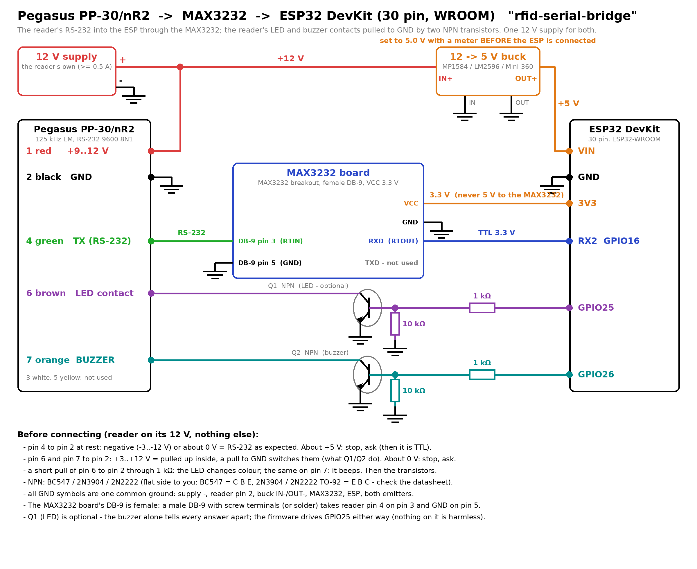
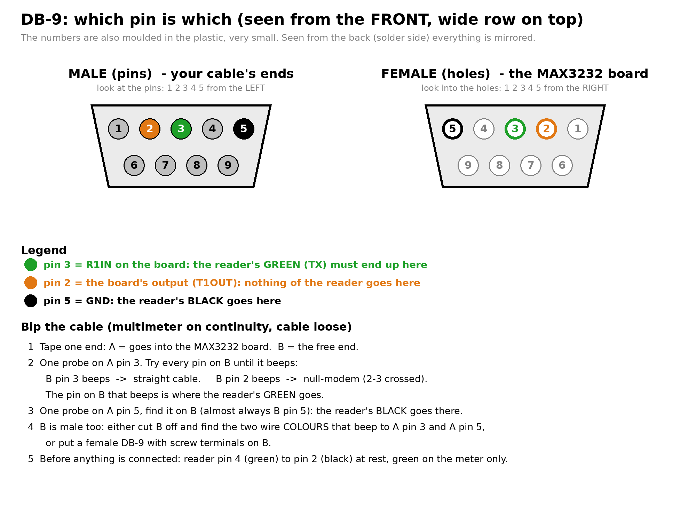

# rfid-rs232-esp32-mqtt

**An ESP32 bridge for 125 kHz EM4100 RFID readers with RS-232 ASCII output.** It reads the reader's serial line,
accepts only frames with a correct EM4100 checksum, debounces a held tag, publishes the reading over MQTT with
TLS, and turns your home automation's answer into the reader's buzzer and LED. Built with [ESPHome](https://esphome.io),
running at a front door with a Pegasus PP-30/nR2 reader and [openHAB](https://www.openhab.org) since November 2026.



The bridge **never decides**. It checks and forwards; openHAB (or Home Assistant, or Node-RED) looks the tag up and
arms, disarms or denies. That keeps the list of tags, and the alarm, where they belong: not in a board at the door.

---

## Contents

- [Why](#why)
- [What it does](#what-it-does)
- [The answer at the door](#the-answer-at-the-door)
- [Hardware](#hardware)
- [Before you connect: measure](#before-you-connect-measure)
- [The frame on the wire](#the-frame-on-the-wire)
- [Build and flash](#build-and-flash)
- [MQTT](#mqtt)
- [openHAB](#openhab)
- [Other home automation](#other-home-automation)
- [Security](#security)
- [Tests](#tests)
- [Troubleshooting](#troubleshooting)
- [Files](#files)
- [License](#license)

---

## Why

Older access readers speak RS-232. The usual way to get them on the network is a serial-to-Ethernet box that forwards
every byte as UDP. That works until it does not:

| a serial box over UDP | this bridge |
|---|---|
| forwards whatever arrives - a misread at the door becomes a reading | only 12 hex digits with a correct EM4100 checksum pass; the rest is counted as a bad frame |
| UDP, no acknowledgement - a lost packet is lost silently | MQTT QoS 1; a reading that cannot be delivered is **dropped and counted**, never sent late |
| the tag ID crosses the LAN in clear text | MQTT over TLS, verified against the broker's root certificate |
| "is it alive?" = does its web page answer (the reader can be dead behind it) | the board's own MQTT last will, plus counters for good, bad and lost readings |
| no way to answer the person at the door | arm / disarm / denied as beeps (and LED) on the reader |
| a reading lands in an item with a state - a restart that restores states can replay it | a **trigger channel** in openHAB: an event, no state, nothing to replay |

## What it does

- **Reads** the reader's RS-232 at 9600 8N1 through a MAX3232 into UART2 of an ESP32.
- **Checks** each frame: exactly 12 hex digits (the tag's 10-digit EM4100 ID + a 2-digit XOR checksum of its 5 bytes),
  checksum correct. STX/ETX, CR/LF, NUL padding and lower case are all accepted around it; 11 or 13 digits, a wrong
  checksum or a frame broken off mid-way are not.
- **Debounces**: the same tag again within 3 s of its *last* reading is the same presentation, so a tag held at the
  reader gives one reading, not one every few hundred milliseconds. A different tag always passes.
- **Publishes** the 12 digits on `<topic_base>/tag`, QoS 1, **not retained** (a retained reading would act again at
  every reconnect). With no broker, the reading is dropped, counted and answered with three long beeps.
- **Answers**: `arm`, `disarm` or `denied` on `<topic_base>/feedback` becomes beeps and LED - **only within 10 s of its
  own reading**, so a stray or replayed message never beeps at an empty door.
- **Reports** itself: online/offline (birth and last will), WiFi signal, uptime, readings published / bad / lost,
  firmware version, IP, MAC, WiFi network and access point.
- **Never logs a full tag ID** - only the last four digits. A full EM4100 ID is all it takes to clone a tag.

## The answer at the door

| answer on `<topic_base>/feedback` | the reader |
|---|---|
| `arm` | two short beeps (+ LED 2 s) |
| `disarm` | one short beep (+ LED 2 s) |
| `denied` | three long beeps, no LED |
| *(no broker when the tag was read)* | three long beeps - **nothing happened** |

The last line is the reason to fit the buzzer at all: without it, a reading that never reached your automation looks
exactly like one that did, and you walk away from a house that was not armed. The buzzer alone tells all four apart;
the LED is optional.

**The PP-30 beeps and blinks by itself at every read** - before any answer, whatever the tag. So the answer comes
*on top of* the reader's own beep: what you hear for `disarm` is the reader's beep and then one more. Two things
follow:

- choose patterns that stay apart with that extra beep in front - one short after the reader's beep is easily heard
  as the two of `arm`; a long beep for one of them is safer (`script: feedback` takes the count and the length);
- **the reader's own beep and nothing after it = the reading did not reach your automation** (or it did not answer
  within 10 s). Its own beep never means "accepted".

---

## Hardware

| part | what | notes |
|---|---|---|
| ESP32 | 30-pin ESP32-WROOM DevKit (`esp32dev`) | RX2 = GPIO16; GPIO25 / GPIO26 drive the transistors (no boot strapping pins) |
| RS-232 | MAX3232 breakout with a female DB-9 and a 4-pin header (VCC, GND, TXD, RXD) | **VCC from the ESP's 3V3, never 5 V** - its TTL output follows VCC, and 5 V into an ESP input is out of spec. A plain MAX232 (no "3") needs 5 V: not that one |
| power | the reader's 12 V supply (>= 0.5 A) + a 12 -> 5 V buck to the ESP's VIN: a fixed 5 V module (running here: a 15 W DC-DC, 7-20 V in, 5 V / 3 A out) or an adjustable one (MP1584 / LM2596 / Mini-360) | an adjustable one: **set it to 5.0 V with a meter before the ESP is on it** |
| cable | a DB-9 into the MAX3232 board; the reader's TX on its pin 3, GND on pin 5 | a male DB-9 with screw terminals, or a cable with one end cut off - bip it first (below) |
| buzzer driver | 1 x NPN (BC547 / 2N3904 / 2N2222), 1 kΩ (GPIO -> base), 10 kΩ (base -> emitter) | emitter to GND, collector to the reader's buzzer contact. The 10 kΩ keeps it off while the ESP boots |
| LED driver *(optional)* | the same again on GPIO25 -> the reader's LED contact | |

### Wiring



The reader used here, a **Pegasus PP-30/nR2** (125 kHz EM, RS-232 output, label PP30-ID12-B40):

| pin | colour | function | goes to |
|---|---|---|---|
| 1 | red | +9..12 V | the 12 V supply + |
| 2 | black | GND | common ground: supply -, buck IN-/OUT-, ESP GND, MAX3232 GND (DB-9 pin 5) |
| 3 | white | - | not used |
| 4 | green | TX, RS-232 | MAX3232 DB-9 pin 3 (R1IN) |
| 5 | yellow | - | not used |
| 6 | brown | LED contact (pull to GND = on) | NPN collector, optional |
| 7 | orange | buzzer contact (pull to GND = on) | NPN collector |

**One common ground** - the RS-232 signal is a voltage against the reader's ground, and the MAX3232 can only read it
against the same ground. Never put 12 V on the MAX3232 or the ESP: 12 V goes only to the reader and the buck's input.

### The DB-9 and the cable



Male and female DB-9 are mirrored when seen from the front; the numbers moulded in the plastic are always right. Bip
the cable before anything is soldered: a "straight" cable takes pin 3 to pin 3, a null-modem cable takes pin 3 to
pin 2. The reader's TX must end on the board's **pin 3**.

## Before you connect: measure

With the reader on its 12 V and nothing else connected:

1. **Pin 4 (TX) to pin 2 (GND) at rest.** Negative (-3..-12 V) = RS-232, as expected. About 0 V is fine too (RS-232
   polarity at 0/5 V - the MAX3232 switches at about 1.5 V); the PP-30 here measures **0.1-0.2 V** at rest and is read
   without any inversion. **About +5 V = TTL with normal polarity**: the MAX3232
   inverts it, so add `inverted: true` to the UART's `rx_pin` and keep the MAX3232 (it takes 0-5 V on its input, and
   the ESP never sees 5 V). Measure with the green wire on the meter only - the MAX3232's input would pull it down.
2. **Pin 6 and pin 7 to pin 2.** +3..+12 V = pulled up inside, a pull to GND switches them - what the NPNs do.
   About 0 V: stop - they are driven the other way and the drivers need rethinking.
3. **A short pull of pin 7 to pin 2 through 1 kΩ**: it beeps. The same on pin 6: the LED changes. Then the transistors.
4. The buck: 12 V in, adjust to **5.0 V** out with the meter, then the ESP on VIN.

---

## The frame on the wire

```
STX  1 2 3 4 5 6 7 8 9 A  9 2  CR LF ETX        (an invented tag)
02   \______ ID _______/  \_/  0D 0A 03
      5 bytes: 12 34 56 78 9A
                          XOR: 12 ^ 34 ^ 56 ^ 78 ^ 9A = 92
```

`rfid_frame.h` is the whole decoder, small enough to read in a minute and tested on the host:

- a frame is a run of hex digits, ended by anything that is not one (CR, LF, STX/ETX, NUL) or by a pause of
  `GAP_MS` (100 ms; 16 bytes at 9600 baud take about 17 ms);
- it is **OK** only with exactly 12 digits and a correct checksum; anything else is **BAD** and counted;
- `Debounce` holds the last UID for `HOLD_MS` (3 s) after its *last* reading (a sliding window), so a held tag is
  one reading however long it is held;
- `millis()` wrapping after 49 days is handled.

## Build and flash

You need [ESPHome](https://esphome.io/guides/installing_esphome) (2025.x or later; built and running with 2026.6.2).

```bash
cp secrets.example.yaml secrets.yaml      # fill in WiFi, MQTT and the broker's root certificate
esphome compile rfid-serial-bridge.yaml
```

**First flash over USB** - either from the machine with ESPHome:

```bash
esphome upload rfid-serial-bridge.yaml --device /dev/ttyUSB0
```

or copy `.esphome/build/rfid-serial-bridge/.pioenvs/rfid-serial-bridge/firmware.factory.bin` to a computer and
flash it with [ESPHome Web](https://web.esphome.io) in Chrome or Edge, or with `esptool`
(`esptool --chip esp32 -p <port> write-flash 0x0 firmware.factory.bin`). **The image contains your WiFi and MQTT
passwords**: copy, flash, delete - never publish it.

**After that, over the air:**

```bash
esphome upload rfid-serial-bridge.yaml --device rfid-serial-bridge.local    # or its IP
```

What you may want to change, all in `rfid-serial-bridge.yaml`:

| what | where |
|---|---|
| topic base (default `rfid/door`) | `substitutions: topic_base` |
| the RX pin, or `inverted: true` for a TTL reader | `uart: rx_pin` |
| baud rate (9600 8N1 for the PP-30) | `uart:` |
| buzzer / LED pins | `output:` |
| the beep patterns | `mqtt: on_message` and `script: feedback` |
| debounce and frame gap | `HOLD_MS`, `GAP_MS` in `rfid_frame.h` |

## MQTT

Broker on **8883 with TLS**, the root certificate in `secrets.yaml` (`mqtt_ca`).

| topic | direction | content |
|---|---|---|
| `<base>/tag` | bridge -> you | 12 hex digits, QoS 1, **not retained** |
| `<base>/feedback` | you -> bridge | `arm` / `disarm` / `denied`, **not retained**; acted on only within 10 s of a reading |
| `<base>/bridge/status` | bridge | `online` / `offline` - birth message and last will |
| `<base>/bridge/online` | bridge | `ON` / `OFF` (ESPHome's status sensor) |
| `<base>/bridge/rssi` | bridge | WiFi signal, dBm, every 60 s |
| `<base>/bridge/uptime` | bridge | seconds, every 60 s |
| `<base>/bridge/reads_ok`, `reads_bad`, `reads_lost` | bridge | counters since boot, every 60 s |
| `<base>/bridge/version` | bridge | ESPHome version and build time |
| `<base>/bridge/ip`, `mac`, `ssid`, `bssid` | bridge | where it is on the network |

`<base>` = `topic_base`, `rfid/door` by default. Have exactly **one** writer of `<base>/feedback`: the rule that
decides.

## openHAB

A complete, tested example is in [`openhab/`](openhab/):

| file | what |
|---|---|
| [`things/rfid_bridge.things`](openhab/things/rfid_bridge.things) | the bridge as an MQTT thing: `tag` is a **trigger channel**, the rest are states |
| [`items/rfid_bridge.items`](openhab/items/rfid_bridge.items) | the bridge's state, two records, and the two alarm items the example uses |
| [`automation/js/rfid-reader.js`](openhab/automation/js/rfid-reader.js) | the rule (JavaScript Scripting): look up, arm/disarm/deny, answer |

**Why a trigger channel, not an item.** If the reading lands in a String item and a rule fires on its update, then
anything that sets that item again - a restart that restores item states from persistence, an items-file reload -
runs the rule again with the last tag, and toggles the alarm with nobody at the door. A channel event has no state;
nothing can replay it.

**Is it alive?** `RfidBridge_Online` follows the board's last will. A rule every few minutes that mails or texts you
when it has been `OFF` for longer than a reboot takes (say 150 s) is the health check worth having; an
`OFF -> ON` blip during an OTA update is normal.

## Other home automation

Nothing here is openHAB-specific except the example: subscribe to `<base>/tag`, decide, publish one word on
`<base>/feedback` within 10 s. In Home Assistant that is an MQTT `event` (not a `sensor` - the same restore problem)
and an automation; in Node-RED an `mqtt in` -> `switch` -> `mqtt out`.

## Security

- **TLS** to the broker, the server certificate verified against the root in `mqtt_ca`. No plain MQTT.
- **No retained readings or answers**, so nothing acts again at a reconnect.
- **No late readings**: a reading that cannot be published is dropped and counted, never queued - a late reading
  would arm or disarm minutes later.
- **The answer window**: the board acts on an answer only within 10 s of its own reading.
- **No full tag IDs in logs**, on the board or in the example rule (unknown tags excepted: you need them to add them).
- **No secrets in this repository**: `secrets.yaml` and every build output are git-ignored; the images carry passwords.
- EM4100 itself is not secure - a read-only 40-bit ID that anyone close enough can read and copy. Treat it as a
  convenience on top of an alarm with its own code, not as the lock.

## Tests

The decoder and the debounce, on the host - no hardware:

```bash
g++ -std=c++17 -Wall -I. tests/rfid_frame_test.cpp -o /tmp/rfid_frame_test && /tmp/rfid_frame_test
# 21 checks, 0 failed
```

Covered: a plain CRLF frame, STX/ETX framing, NUL padding, lower case, a wrong checksum, 11 and 13 digits, a frame
ended by a pause, a broken start followed by a whole frame, two frames back to back, terminators alone, `millis()`
wrapping, a held tag, a different tag, a reading at t = 0. The tags in the test are invented; only their checksums
are right.

## Troubleshooting

| what you see | likely cause |
|---|---|
| online, but nothing arrives on `<base>/tag` and `reads_bad` stays 0 | no signal on R1IN: the TX on the wrong DB-9 pin (a null-modem cable), or no common ground |
| `reads_bad` climbs with every tag | wrong polarity (a TTL reader: `inverted: true`), wrong baud rate, or a reader set to Wiegand / magstripe instead of serial ASCII |
| readings arrive twice a few seconds apart | the tag was presented twice with more than 3 s between - raise `HOLD_MS` if you prefer |
| `reads_lost` > 0 | the broker was unreachable when a tag was read (WiFi, DNS, certificate) - the reader gave three long beeps |
| the board connects to WiFi but never to MQTT | the root certificate does not match the broker's chain, the broker name is not the one the certificate is issued for, or the board has no time yet (TLS needs the clock: SNTP) |
| the buzzer beeps at boot | the 10 kΩ base-emitter resistor is missing |
| no beep after `arm` | the answer came more than 10 s after the reading (the board's log says so), or the NPN is wired C/E the wrong way round (BC547 and 2N3904 have different pinouts) |

## Files

| file | |
|---|---|
| [`rfid-serial-bridge.yaml`](rfid-serial-bridge.yaml) | the ESPHome configuration |
| [`rfid_frame.h`](rfid_frame.h) | the frame check and the debounce, included by the YAML |
| [`secrets.example.yaml`](secrets.example.yaml) | what `secrets.yaml` must contain |
| [`tests/rfid_frame_test.cpp`](tests/rfid_frame_test.cpp) | the host test |
| [`openhab/`](openhab/) | the openHAB example (thing, items, rule) |
| [`docs/`](docs/) | the drawings; [`tools/draw-*.py`](tools/) draws them (Pillow) |

## License

[MIT](LICENSE).
